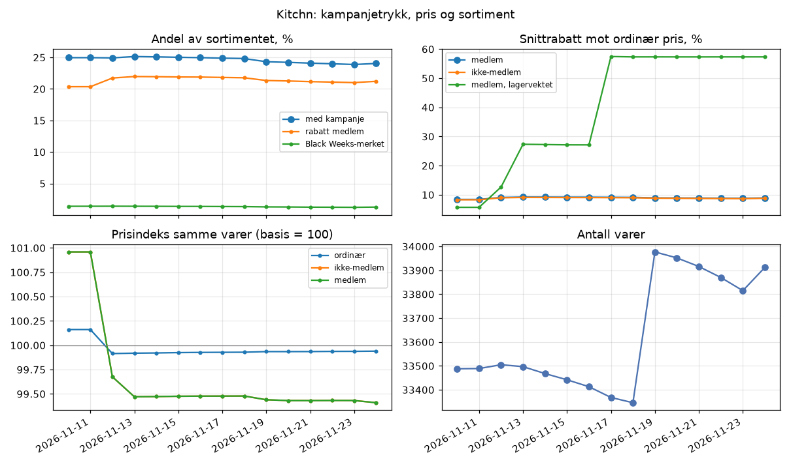

# Kitchn og Tilbords: siste kjøring

## Kitchn (2026-11-23, 14 kjøringer)

| Mål | Siste | Forrige |
|---|---:|---:|
| Varer | 33 815 | 33 870 |
| Andel med kampanje | 23,9 % | 24,0 % |
| Andel Black Weeks-merket | 1,2 % | 1,2 % |
| Snittrabatt medlem | 8,8 % | 8,8 % |
| Snittrabatt ikke-medlem | 8,7 % | 8,7 % |
| Prisindeks medlem (basis 100) | 99,4 | 99,4 |
| Andel på nettlager | 80,7 % | 81,7 % |

## Tilbords (2026-11-23, 14 kjøringer)

| Mål | Siste | Forrige |
|---|---:|---:|
| Varer | 35 792 | 35 809 |
| Andel med kampanje | 26,8 % | 26,9 % |
| Andel Black Weeks-merket | 1,0 % | 1,0 % |
| Snittrabatt medlem | 10,1 % | 10,1 % |
| Snittrabatt ikke-medlem | 10,0 % | 10,1 % |
| Prisindeks medlem (basis 100) | 99,7 | 99,7 |
| Andel på nettlager | 81,8 % | 82,7 % |

Full rapport: `rapport/kitchn_tracker.xlsx` og `rapport/tilbords_tracker.xlsx`. Forklaring av målene står i arket «Forklaring».
