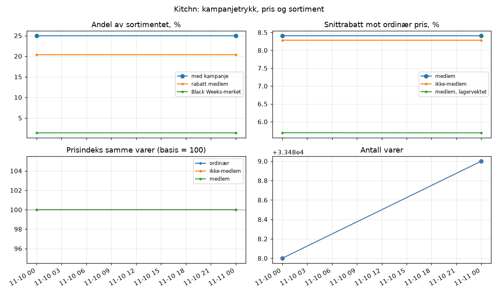
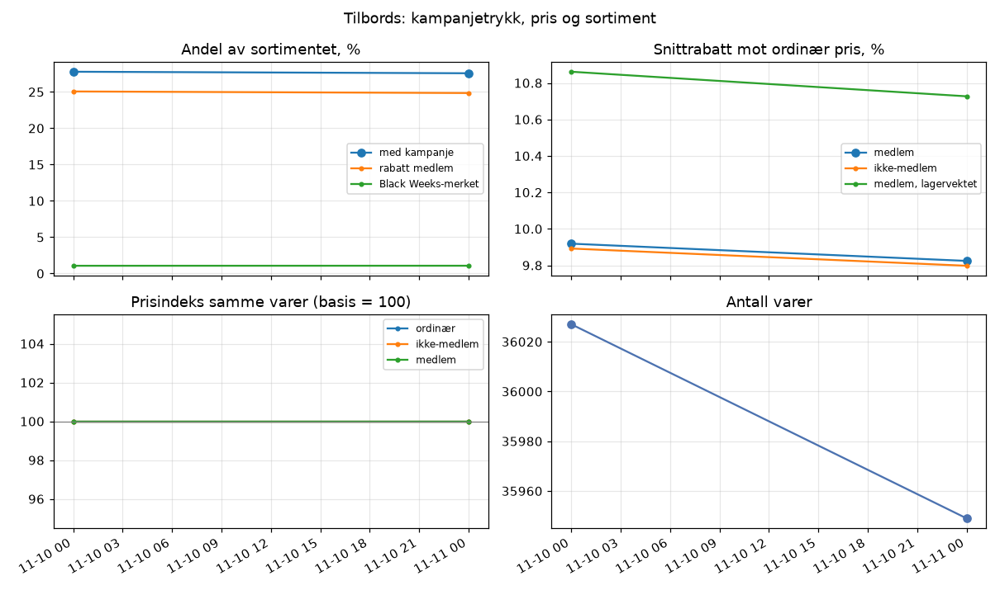

# Kitchn og Tilbords: siste kjøring

## Kitchn (2026-11-11, 2 kjøringer)

| Mål | Siste | Forrige |
|---|---:|---:|
| Varer | 33 489 | 33 488 |
| Andel med kampanje | 25,0 % | 25,0 % |
| Andel Black Weeks-merket | 1,4 % | 1,4 % |
| Snittrabatt medlem | 8,4 % | 8,4 % |
| Snittrabatt ikke-medlem | 8,3 % | 8,3 % |
| Prisindeks medlem (basis 100) | 100,0 | 100,0 |
| Andel på nettlager | 84,9 % | 84,7 % |

## Tilbords (2026-11-11, 2 kjøringer)

| Mål | Siste | Forrige |
|---|---:|---:|
| Varer | 35 949 | 36 027 |
| Andel med kampanje | 27,6 % | 27,8 % |
| Andel Black Weeks-merket | 1,1 % | 1,1 % |
| Snittrabatt medlem | 9,8 % | 9,9 % |
| Snittrabatt ikke-medlem | 9,8 % | 9,9 % |
| Prisindeks medlem (basis 100) | 100,0 | 100,0 |
| Andel på nettlager | 84,6 % | 84,5 % |

Full rapport: `rapport/kitchn_tracker.xlsx` og `rapport/tilbords_tracker.xlsx`. Forklaring av målene står i arket «Forklaring».
