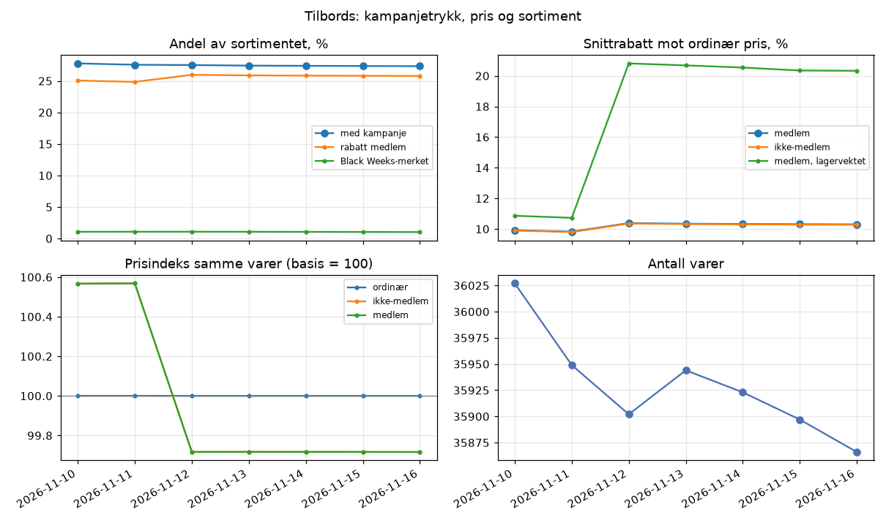

# Kitchn og Tilbords: siste kjøring

## Kitchn (2026-11-18, 9 kjøringer)

| Mål | Siste | Forrige |
|---|---:|---:|
| Varer | 33 346 | 33 368 |
| Andel med kampanje | 24,8 % | 24,9 % |
| Andel Black Weeks-merket | 1,3 % | 1,4 % |
| Snittrabatt medlem | 9,1 % | 9,1 % |
| Snittrabatt ikke-medlem | 9,0 % | 9,0 % |
| Prisindeks medlem (basis 100) | 99,5 | 99,5 |
| Andel på nettlager | 83,7 % | 84,1 % |

## Tilbords (2026-11-18, 9 kjøringer)

| Mål | Siste | Forrige |
|---|---:|---:|
| Varer | 35 853 | 35 851 |
| Andel med kampanje | 27,2 % | 27,3 % |
| Andel Black Weeks-merket | 1,0 % | 1,0 % |
| Snittrabatt medlem | 10,2 % | 10,3 % |
| Snittrabatt ikke-medlem | 10,2 % | 10,2 % |
| Prisindeks medlem (basis 100) | 99,7 | 99,7 |
| Andel på nettlager | 84,1 % | 84,3 % |

Full rapport: `rapport/kitchn_tracker.xlsx` og `rapport/tilbords_tracker.xlsx`. Forklaring av målene står i arket «Forklaring».
