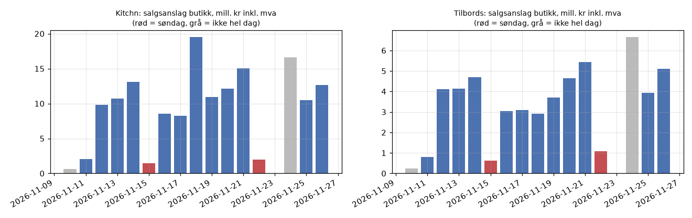

# Salgsanslag fra butikklager (sideprosjekt)

Nedre anslag på salg i fysiske butikker: fall i lager per vare og butikk fra én nattkjøring til neste. Påfyll skjuler salg, så bruk tallene som indeks. Holdes utenfor hovedrapporten. Skrus av med `SALGSANSLAG = False` i `scraper/config.py`.

## Kitchn

**Vurdering: FOR TIDLIG: avgjøres innen 2026-11-23**

| Kontroll | Status | Resultat | Krav |
|---|---|---|---|
| 1 Søndag nær null | OK | søndag = 13% av en vanlig dag | søndag < 25 % av median hverdag |
| 2 Ukemønster | OK | største dager: lør, ons; man-ons 32,692 mot tor-lør 32,706 enheter | lørdag blant de to største; man-ons lavere enn tor-lør |
| 3 Stabil fordeling | VENTER | har 7 av 8 hele dager før Black Week | kategorier ≥ 0,85 og butikker ≥ 0,80 |
| 4 Black Week-løft | VENTER | 0 dager i Black Week (2026-11-23 til 2026-11-30) | totalt > 1,3x ukene før, og større løft på kampanjevarer enn fullpris |
| 5 Nivå | FEIL | anslaget x 365 = 266% av årsomsetningen i butikk | 20-150 % (nedre anslag; november er ikke en snittmåned) |

Oppdatering av lagertall: Løpende: lageret endrer seg i løpet av dagen

Sentrallager holdt utenfor: 80, 582

| Salgsdag | Dag | Timer | Solgt, enheter | Mill. kr (medlem, inkl. mva) | Påfyll | Andel salg kampanje | Sentrallager ut | Nett: gikk tom / tilbake | Metode |
|---|---|---:|---:|---:|---:|---:|---:|---|---|
| 2026-11-10 | tir | 11.8 | 1 737 | 0.62 | 4 353 | 62% | – | 43 / 102 | sum per vare (grov) |
| 2026-11-11 | ons | 24.0 | 6 370 | 2.08 | 26 662 | 56% | – | 83 / 107 | sum per vare (grov) |
| 2026-11-12 | tor | 24.0 | 28 302 | 9.83 | 21 404 | 77% | 236 | 293 / 262 | vare x butikk |
| 2026-11-13 | fre | 23.9 | 31 648 | 10.70 | 16 961 | 77% | 439 | 214 / 160 | vare x butikk |
| 2026-11-14 | lør | 24.1 | 38 169 | 13.09 | 7 092 | 77% | 523 | 224 / 111 | vare x butikk |
| 2026-11-15 | søn | 24.2 | 3 999 | 1.43 | 2 254 | 80% | 57 | 228 / 203 | vare x butikk |
| 2026-11-16 | man | 23.8 | 25 400 | 8.56 | 18 504 | 77% | 270 | 273 / 256 | vare x butikk |
| 2026-11-17 | tir | 24.0 | 24 365 | 8.27 | 18 358 | 77% | 2 273 688 | 263 / 149 | vare x butikk |
| 2026-11-18 | ons | 24.0 | 48 312 | 19.49 | 24 733 | 88% | 226 | 218 / 120 | vare x butikk |

## Tilbords

**Vurdering: FOR TIDLIG: avgjøres innen 2026-11-23**

| Kontroll | Status | Resultat | Krav |
|---|---|---|---|
| 1 Søndag nær null | OK | søndag = 17% av en vanlig dag | søndag < 25 % av median hverdag |
| 2 Ukemønster | OK | største dager: lør, tor; man-ons 9,622 mot tor-lør 13,277 enheter | lørdag blant de to største; man-ons lavere enn tor-lør |
| 3 Stabil fordeling | VENTER | har 7 av 8 hele dager før Black Week | kategorier ≥ 0,85 og butikker ≥ 0,80 |
| 4 Black Week-løft | VENTER | 0 dager i Black Week (2026-11-23 til 2026-11-30) | totalt > 1,3x ukene før, og større løft på kampanjevarer enn fullpris |
| 5 Nivå | FEIL | anslaget x 365 = 235% av årsomsetningen i butikk | 20-150 % (nedre anslag; november er ikke en snittmåned) |

Oppdatering av lagertall: Løpende: lageret endrer seg i løpet av dagen

Sentrallager holdt utenfor: ingen

| Salgsdag | Dag | Timer | Solgt, enheter | Mill. kr (medlem, inkl. mva) | Påfyll | Andel salg kampanje | Sentrallager ut | Nett: gikk tom / tilbake | Metode |
|---|---|---:|---:|---:|---:|---:|---:|---|---|
| 2026-11-10 | tir | 11.8 | 839 | 0.25 | 12 804 | 70% | – | 84 / 136 | sum per vare (grov) |
| 2026-11-11 | ons | 24.0 | 2 533 | 0.80 | 18 752 | 63% | – | 114 / 150 | sum per vare (grov) |
| 2026-11-12 | tor | 24.0 | 12 869 | 4.10 | 5 641 | 82% | 0 | 322 / 390 | vare x butikk |
| 2026-11-13 | fre | 23.9 | 12 536 | 4.14 | 4 368 | 78% | 0 | 241 / 188 | vare x butikk |
| 2026-11-14 | lør | 24.1 | 14 427 | 4.70 | 785 | 78% | 0 | 220 / 113 | vare x butikk |
| 2026-11-15 | søn | 24.2 | 1 905 | 0.63 | 923 | 82% | 0 | 257 / 242 | vare x butikk |
| 2026-11-16 | man | 23.8 | 9 661 | 3.05 | 5 149 | 79% | 0 | 292 / 314 | vare x butikk |
| 2026-11-17 | tir | 24.0 | 9 850 | 3.09 | 6 830 | 78% | 0 | 289 / 246 | vare x butikk |
| 2026-11-18 | ons | 24.0 | 9 356 | 2.91 | 6 590 | 78% | 0 | 238 / 151 | vare x butikk |

