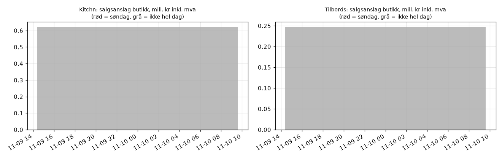

# Salgsanslag fra butikklager (sideprosjekt)

Nedre anslag på salg i fysiske butikker: fall i lager per vare og butikk fra én nattkjøring til neste. Påfyll skjuler salg, så bruk tallene som indeks. Holdes utenfor hovedrapporten. Skrus av med `SALGSANSLAG = False` i `scraper/config.py`.

## Kitchn

**Vurdering: FOR TIDLIG: avgjøres innen 2026-11-23**

| Kontroll | Status | Resultat | Krav |
|---|---|---|---|
| 1 Søndag nær null | VENTER | trenger en hel søndag og tre hverdager | søndag < 25 % av median hverdag |
| 2 Ukemønster | VENTER | har 0 av 6 ukedager før Black Week | lørdag blant de to største; man-ons lavere enn tor-lør |
| 3 Stabil fordeling | VENTER | har 0 av 8 hele dager før Black Week | kategorier ≥ 0,85 og butikker ≥ 0,80 |
| 4 Black Week-løft | VENTER | 0 dager i Black Week (2026-11-23 til 2026-11-30) | totalt > 1,3x ukene før, og større løft på kampanjevarer enn fullpris |
| 5 Nivå | VENTER | trenger 5 hele dager før Black Week | 20-150 % av årsomsetning i butikk |

Oppdatering av lagertall: VENTER: lagersjekk kjøres 12.-18. november

Sentrallager holdt utenfor: 582

| Salgsdag | Dag | Timer | Solgt, enheter | Mill. kr (medlem, inkl. mva) | Påfyll | Andel salg kampanje | Sentrallager ut | Nett: gikk tom / tilbake | Metode |
|---|---|---:|---:|---:|---:|---:|---:|---|---|
| 2026-11-10 | tir | 11.8 | 1 737 | 0.62 | 4 353 | 62% | – | 43 / 102 | sum per vare (grov) |

## Tilbords

**Vurdering: FOR TIDLIG: avgjøres innen 2026-11-23**

| Kontroll | Status | Resultat | Krav |
|---|---|---|---|
| 1 Søndag nær null | VENTER | trenger en hel søndag og tre hverdager | søndag < 25 % av median hverdag |
| 2 Ukemønster | VENTER | har 0 av 6 ukedager før Black Week | lørdag blant de to største; man-ons lavere enn tor-lør |
| 3 Stabil fordeling | VENTER | har 0 av 8 hele dager før Black Week | kategorier ≥ 0,85 og butikker ≥ 0,80 |
| 4 Black Week-løft | VENTER | 0 dager i Black Week (2026-11-23 til 2026-11-30) | totalt > 1,3x ukene før, og større løft på kampanjevarer enn fullpris |
| 5 Nivå | VENTER | trenger 5 hele dager før Black Week | 20-150 % av årsomsetning i butikk |

Oppdatering av lagertall: VENTER: lagersjekk kjøres 12.-18. november

Sentrallager holdt utenfor: ingen

| Salgsdag | Dag | Timer | Solgt, enheter | Mill. kr (medlem, inkl. mva) | Påfyll | Andel salg kampanje | Sentrallager ut | Nett: gikk tom / tilbake | Metode |
|---|---|---:|---:|---:|---:|---:|---:|---|---|
| 2026-11-10 | tir | 11.8 | 839 | 0.25 | 12 804 | 70% | – | 84 / 136 | sum per vare (grov) |

